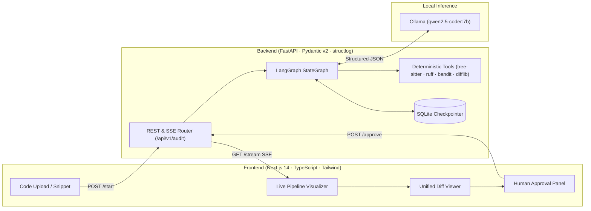
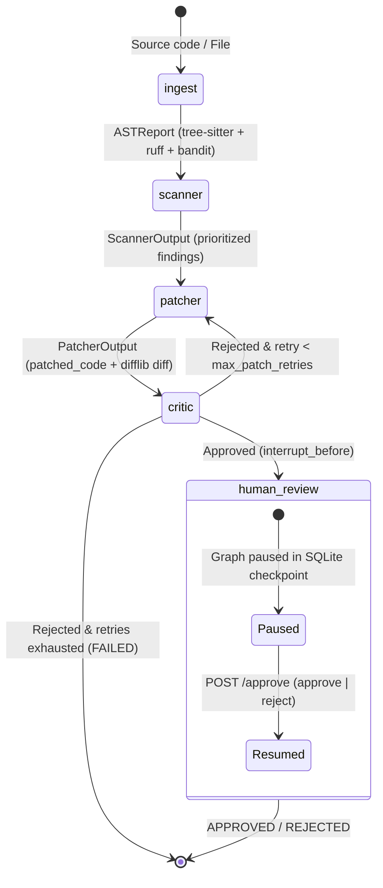

# HuGuard AI

> **Autonomous, 100% local Multi-Agent Codebase & Security Auditor** built with **LangGraph**, **FastAPI**, **Ollama**, **Tree-sitter**, and **Next.js 14**.

HuGuard AI combines deterministic static analysis (`tree-sitter`, `ruff`, `bandit`) with a cyclic multi-agent LangGraph state machine and a **Human-in-the-Loop (HITL)** approval gate. Every vulnerability scan, patch generation, critic verification, and human sign-off runs entirely on your local machine—zero cloud APIs, zero telemetry, zero data exfiltration.

---

## Architecture Overview



---

## LangGraph Cyclic State Machine

Unlike linear LLM chains, HuGuard AI uses a **cyclic `StateGraph`** with SQLite checkpoint persistence and `interrupt_before=["human_review"]`:



### Why These Engineering Decisions?

| Decision | Rationale |
|---|---|
| **Deterministic tools before LLM** | `tree-sitter`, `ruff`, and `bandit` run first to extract exact AST symbols, complexity, and known rules. This grounds the Scanner agent and cuts hallucinations. |
| **In-process `difflib` instead of LLM diffs** | Smaller local models frequently produce broken unified diff headers or off-by-one hunk counts. The Patcher emits the full patched file; `difflib` computes an exact unified diff. |
| **Two-phase Critic node** | Phase 1 runs `ast.parse()` deterministically. Syntax errors short-circuit immediately without wasting LLM inference time; only syntactically valid patches reach Phase 2 semantic review. |
| **`interrupt_before` + `AsyncSqliteSaver`** | The graph pauses cleanly before `human_review`, persists the full `AuditState` to SQLite, and resumes on `POST /api/v1/audit/{thread_id}/approve`—even across backend restarts. |
| **Bounded retry cycle (`max_patch_retries = 2`)** | Critic feedback flows back into the Patcher prompt for self-correction while preventing infinite loops. |
| **Static fallback on LLM failure** | If Ollama returns malformed JSON after 3 attempts, the Scanner falls back to deterministic `ruff`/`bandit` findings rather than crashing the pipeline. |

---

## Tech Stack

- **Backend:** Python 3.11+, FastAPI, Pydantic v2 (`pydantic-settings`), `structlog` (JSON in prod, console in TTY)
- **Agent Orchestration:** LangGraph (`StateGraph`, `AsyncSqliteSaver`, `interrupt_before`), `langchain-ollama`
- **Static Analysis:** `tree-sitter` (Python & JS/TS AST), `ruff`, `bandit`, Python `ast`
- **Frontend:** Next.js 14 (App Router, standalone build), TypeScript (`strict: true`, `noUncheckedIndexedAccess`, `exactOptionalPropertyTypes`), Tailwind CSS, Lucide Icons, native `EventSource` SSE
- **Testing & CI:** `pytest`, `pytest-asyncio`, `pytest-cov`, `mypy --strict`, `ruff`, `bandit`, GitHub Actions

---

## Project Structure

```text
HuGuard/
├── docker-compose.yml              # Backend + Frontend + host.docker.internal Ollama bridge
├── .env.example                    # Environment configuration template
├── .github/workflows/ci.yml        # Ruff, mypy, bandit, pytest, tsc, eslint, Docker build
├── backend/
│   ├── Dockerfile                  # Multi-stage Python 3.11 slim image (non-root appuser)
│   ├── pyproject.toml              # Ruff, mypy, pytest, coverage config
│   ├── requirements.txt
│   ├── app/
│   │   ├── main.py                 # FastAPI app, lifespan, CORS, global error handler
│   │   ├── core/                   # config.py (pydantic-settings), logging.py (structlog)
│   │   ├── schemas/audit.py        # Pydantic v2 models for API, Agents, State & SSE
│   │   ├── tools/                  # code_analysis.py (tree-sitter/ruff/bandit), diff_utils.py
│   │   ├── agents/                 # scanner.py, patcher.py, critic.py
│   │   ├── graph/audit_graph.py    # Cyclic LangGraph StateGraph + SSE streaming + HITL resume
│   │   ├── services/ingestion.py   # Snippet, single-file, and ZIP archive extraction
│   │   └── routers/audit.py        # /api/v1/audit endpoints
│   └── tests/
│       ├── conftest.py
│       ├── test_tools.py           # AST extraction, ruff/bandit, syntax validation
│       ├── test_scanner.py         # Structured output & JSON-failure fallback
│       ├── test_graph_routing.py   # Cyclic retry routing & HITL interrupt transitions
│       └── test_api.py             # FastAPI endpoint validation (202/404/409/422)
└── frontend/
    ├── Dockerfile                  # Multi-stage Node 20 Alpine standalone build (non-root)
    ├── next.config.mjs
    ├── tsconfig.json               # Strict TypeScript configuration
    └── src/
        ├── app/                    # layout.tsx, globals.css, page.tsx
        ├── components/audit/       # CodeUpload, PipelineVisualizer, FindingsList, DiffViewer, ApprovalPanel
        ├── hooks/useAuditStream.ts # EventSource SSE state machine
        ├── lib/                    # api.ts, utils.ts
        └── types/audit.ts          # 1:1 mirror of backend Pydantic schemas
```

---

## Quick Start (Docker - Recommended)

Docker is the recommended way to build and run HuGuard AI as it guarantees consistent Python 3.11 runtimes, C++ compilation dependencies for `tree-sitter`, and isolates OS-level dependencies.

### Prerequisites

1. **Docker & Docker Compose** installed and running
2. **Ollama** installed and running on your host machine:
   ```bash
   ollama pull qwen2.5-coder:7b
   ollama serve
   ```

### 1. Build and Run the Stack

```bash
# Copy environment template if not done yet
cp .env.example .env

# Build backend and frontend services
docker compose build

# Start services in the foreground (or add -d for detached mode)
docker compose up
```

- **Frontend UI:** [http://localhost:3000](http://localhost:3000)
- **Backend API & Swagger Docs:** [http://localhost:8000/docs](http://localhost:8000/docs)
- **Health Check:** [http://localhost:8000/health](http://localhost:8000/health)

### 2. Run Backend Test Suite via Docker

To execute all unit, integration, and cyclic graph routing tests in the isolated backend container:

```bash
docker compose run --rm backend pytest tests/ -v --cov=app
```

---

## Local Development (Without Docker)

> **Note on Local Python Environments:**
> Running natively on host machines requires **Python 3.11 or 3.12 (64-bit)** with standard C++ build tools for pre-compiled binary wheels (`tree-sitter`, `pydantic-core`). If using local pip, always use a virtual environment:

### Backend

```bash
cd backend
# Ensure Python 3.11/3.12 is used (e.g. py -3.11 -m venv .venv)
python -m venv .venv
# Linux/macOS: source .venv/bin/activate
# Windows:     .venv\Scripts\activate
pip install -r requirements.txt

uvicorn app.main:app --reload --port 8000
```

Run the test suite (offline, all LLM calls are mocked):

```bash
cd backend
pytest tests/ -v --cov=app
```

### Frontend

```bash
cd frontend
npm install
npm run dev
```

---

## API Endpoints

| Method | Endpoint | Description |
|---|---|---|
| `POST` | `/api/v1/audit/start` | Initiate an audit from a code snippet; returns `thread_id` (`202 Accepted`) |
| `POST` | `/api/v1/audit/start/upload` | Initiate an audit from a `.py`/`.js`/`.ts`/`.zip` upload |
| `GET` | `/api/v1/audit/{thread_id}/stream` | Server-Sent Events (SSE) stream of live LangGraph node transitions |
| `POST` | `/api/v1/audit/{thread_id}/approve` | Resume a paused thread (`awaiting_approval`) with `approve` or `reject` |
| `GET` | `/api/v1/audit/{thread_id}` | Fetch the persisted checkpoint state for a thread |
| `GET` | `/health` | Service health check |
